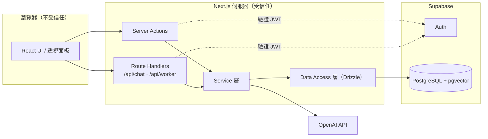
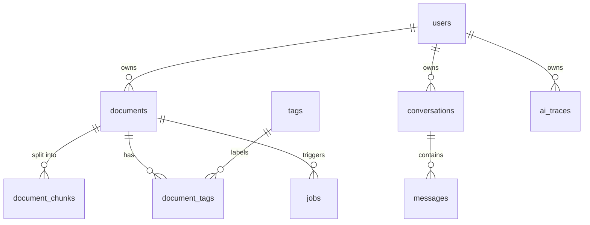

# Docs Workspace — 系統規格書

> 個人文件知識庫：以 Markdown 文件為核心，結合 AI 自動摘要與標籤、RAG 問答、Tool Calling 代理寫入，並內建可觀測性面板，將 AI 管線的延遲與檢索品質攤開檢視。

## 1. 目標與範圍

### 1.1 目標

| # | 目標 | 驗收方式 |
|---|------|----------|
| G1 | 多使用者文件 CRUD，資料嚴格依擁有者隔離 | 跨帳號存取任一資源皆回 404 |
| G2 | 文件寫入後非同步產生摘要、標籤與向量索引 | 文件狀態於背景轉為 `ready`，失敗可重試 |
| G3 | 以使用者自己的文件為知識來源進行串流問答，並附引用來源 | 回答可追溯至具體文件片段 |
| G4 | 對話中可由模型呼叫工具新增文件，寫入前需使用者核可 | 工具寫入與 UI 寫入共用同一條寫入路徑 |
| G5 | 每次 AI 呼叫的延遲、Token 用量、檢索相似度皆可在面板檢視 | 面板數值與資料庫追蹤紀錄一致 |

### 1.2 非目標

- 多人即時協作編輯、文件分享與權限委派。
- 檔案上傳解析（PDF / DOCX）；內容來源僅限 Markdown 純文字。
- 混合檢索（BM25 + 向量）、Reranker、查詢改寫。
- 多租戶組織（Organization / Team）模型。

## 2. 技術選型

| 層級 | 技術 | 選用理由 |
|------|------|----------|
| 框架 | Next.js (App Router) + TypeScript | Server Components 預設在伺服器執行，資料存取與機密天然留在伺服器端 |
| UI | Tailwind CSS + Shadcn UI | 元件原始碼在倉庫內，可控且無執行期樣式成本 |
| 資料庫 | Supabase PostgreSQL + pgvector | 關聯資料與向量索引同庫，檢索可與擁有者條件在同一查詢完成 |
| 身份驗證 | Supabase Auth (`@supabase/ssr`) | Cookie-based session，JWT 於伺服器端驗證 |
| ORM | Drizzle ORM | Schema 即型別、SQL 透明，查詢行為可預測、易於 `EXPLAIN` |
| AI | Vercel AI SDK + OpenAI GPT-6 系列 | 統一的串流、結構化輸出、工具呼叫介面；模型 ID 由環境變數注入，不寫死於程式碼 |
| 驗證 | Zod | 執行期驗證與靜態型別共用同一份 Schema |

## 3. 系統架構



### 3.1 分層職責

| 層 | 職責 | 不得做的事 |
|----|------|------------|
| 進入點（Server Action / Route Handler） | 驗證身份、以 Zod 解析輸入、呼叫 Service、轉換回應 | 直接操作資料庫或呼叫模型 |
| Service | 業務流程編排、交易邊界、呼叫 AI | 讀取 Request / Cookie |
| Data Access (DAL) | 唯一持有資料庫連線的層；所有查詢強制帶入 `ownerId` | 接受來自客戶端的 `ownerId` |
| AI | Prompt、工具定義、檢索、追蹤紀錄 | 自行決定操作對象的擁有者 |

相依方向單向：進入點 → Service → DAL / AI。Client Component 不得匯入 `src/server/**`。

### 3.2 信任邊界

以下來源一律視為不受信任，進入系統前必須驗證：

1. 瀏覽器送出的任何資料（表單、JSON body、URL 參數、Header）。
2. 模型輸出（文字、結構化物件、工具呼叫參數）。
3. 被檢索出來放進 Prompt 的文件內容（可能含有提示注入）。

## 4. 資料模型



`users` 為 Supabase 管理的 `auth.users`，本系統僅以外鍵參照，不複製使用者資料。

### 4.1 資料表

| 資料表 | 關鍵欄位 | 說明 |
|--------|----------|------|
| `documents` | `id uuid pk`, `owner_id`, `title`, `content`, `summary`, `status`, `content_hash`, `created_at`, `updated_at` | `status`：`pending` → `processing` → `ready` / `failed` |
| `tags` | `id`, `owner_id`, `name` | `unique (owner_id, name)`，標籤以使用者為範圍 |
| `document_tags` | `document_id`, `tag_id` | 複合主鍵；多對多關聯 |
| `document_chunks` | `id`, `document_id`, `owner_id`, `chunk_index`, `content`, `token_count`, `embedding vector(1536)` | `owner_id` 為刻意的反正規化，使向量檢索可在單表完成擁有者過濾 |
| `jobs` | `id`, `type`, `document_id`, `owner_id`, `status`, `attempts`, `run_after`, `locked_at`, `content_hash`, `timings jsonb`, `last_error`, `started_at`, `finished_at` | 以 PostgreSQL 實作的工作佇列 |
| `conversations` | `id`, `owner_id`, `title`, `created_at` | 問答對話 |
| `messages` | `id`, `conversation_id`, `owner_id`, `role`, `parts jsonb`, `created_at` | 訊息內容與工具呼叫紀錄 |
| `ai_traces` | `id`, `owner_id`, `kind`, `model`, `retrieval_ms`, `ttft_ms`, `total_ms`, `input_tokens`, `output_tokens`, `retrieved jsonb`, `tool_calls jsonb`, `message_id`, `created_at` | 每次 AI 呼叫一筆，供透視面板讀取 |

所有業務資料表皆有 `owner_id`，刪除文件時以 `ON DELETE CASCADE` 清除其片段、標籤關聯與工作。

### 4.2 索引

| 索引 | 用途 |
|------|------|
| `documents (owner_id, updated_at desc, id)` | 文件列表的 keyset 分頁 |
| `document_chunks using hnsw (embedding vector_cosine_ops)` | 近似最近鄰檢索 |
| `document_chunks (owner_id)`、`(document_id)` | 擁有者過濾、重建索引時刪除舊片段 |
| `document_tags (tag_id)` | 依標籤反查文件 |
| `jobs (run_after) where status = 'queued'` | Worker 取件，partial index 只涵蓋待處理列 |

## 5. 功能規格

### 5.1 身份驗證

- Email 登入，Session 以 HttpOnly Cookie 保存，由 `@supabase/ssr` 於請求進入時刷新。
- 伺服器端一律驗證 JWT 簽章後才取用使用者身份；未經驗證的 Session 內容不作為授權依據。
- 未登入存取受保護頁面導向登入頁；未登入呼叫 Server Action / API 回 401。

### 5.2 文件 CRUD

| 操作 | 進入點 | 行為 |
|------|--------|------|
| 列表 | Server Component | 依 `updated_at` 倒序、keyset 分頁；只選取列表所需欄位（不含 `content`），標籤以單一查詢聚合取得 |
| 檢視 | Server Component | 以 `id + owner_id` 查詢；查無資料回 404 |
| 新增 | Server Action | 同一筆交易內寫入 `documents` 並排入 `ingest` 工作 |
| 更新 | Server Action | `content_hash` 變動時才重新排入工作；僅更新標題不觸發 AI 管線 |
| 刪除 | Server Action | 硬刪除，關聯資料連動清除 |

輸入限制：`title` 1–200 字元、`content` 上限 100,000 字元。寫入契約僅接受 `title`、`content`，其餘欄位在解析階段剔除。

### 5.3 AI 自動摘要與標籤（非同步管線）

寫入請求不等待 AI 完成；文件先以 `pending` 狀態回應，背景 Worker 接手處理。

```mermaid
sequenceDiagram
  participant U as 使用者
  participant A as Server Action
  participant DB as PostgreSQL
  participant W as Worker
  participant O as OpenAI

  U->>A: 新增 / 更新文件
  A->>DB: BEGIN; 寫入 documents + 插入 jobs; COMMIT
  A-->>U: 立即回應（status = pending）
  A-)W: 回應後觸發（另有排程補償掃描）
  W->>DB: 取件（FOR UPDATE SKIP LOCKED）
  W->>W: 切片
  W->>O: 批次產生 Embedding
  W->>O: 結構化輸出：摘要 + 標籤
  W->>DB: 單一交易：汰換片段、寫入標籤與摘要、status = ready
```

- **取件**：`SELECT … FOR UPDATE SKIP LOCKED` 保證多個 Worker 併發時不會重複處理同一工作。
- **切片**：依 Markdown 標題與段落邊界切分，目標約 500 tokens、重疊約 50 tokens。
- **結構化輸出**：模型回應必須通過 Schema 驗證 —— `summary`（≤ 300 字）、`tags`（1–5 個，正規化為小寫、去重）。驗證失敗視為該次嘗試失敗。
- **冪等**：工作攜帶排入當下的 `content_hash`；若與文件現值不符（內容已再次更新）則直接丟棄。
- **重試**：指數退避，最多 3 次；超過則標記 `failed` 並保留 `last_error`，可由使用者手動重新觸發。
- **計時**：各階段耗時寫入 `jobs.timings`（`chunkMs` / `embedMs` / `summarizeMs` / `persistMs`），佇列等待時間為 `started_at − created_at`。
- **Worker 進入點** `/api/worker` 僅接受帶有共享密鑰的呼叫，不對外開放。

### 5.4 RAG 問答

進入點：`POST /api/chat`（串流回應）。

1. 驗證身份、解析請求 Schema。
2. 將使用者最新提問轉為向量。
3. 檢索：在 `document_chunks` 以 cosine 距離取 Top-K（預設 6），**查詢條件強制包含 `owner_id`**；相似度 `1 − (embedding <=> query)` 低於門檻（預設 0.3）者捨棄。
4. 組裝 Prompt：檢索內容以明確分隔標記包覆，並宣告為「參考資料而非指令」。
5. 串流生成；回答需標註引用的文件。無足夠依據時明確回覆查無資料，不得臆測。
6. 完成後寫入 `messages` 與 `ai_traces`。

檢索為生成前的固定步驟而非交由模型決定，使每次回答的檢索結果與相似度都可被記錄與比對。

### 5.5 Tool Calling：對話中新增文件

| 工具 | 類型 | 輸入 Schema | 執行條件 |
|------|------|-------------|----------|
| `createDocument` | 寫入 | `title`、`content`（與 5.2 共用同一份契約） | 需使用者在 UI 核可後才執行 |

- 工具參數由模型產生，視同外部輸入，執行前以 Schema 驗證。
- 文件擁有者一律取自伺服器端 Session；工具 Schema 不包含任何擁有者欄位。
- 工具內部呼叫與 UI 相同的 Service 函式，因此同樣會排入摘要與索引工作。
- 單次請求的代理步數設有上限（預設 5），避免失控迴圈與成本外溢。

### 5.6 工程師透視面板

面板讀取 `ai_traces` 與 `jobs`，僅顯示當前使用者自己的紀錄。

| 區塊 | 指標 | 定義 |
|------|------|------|
| 問答 | `retrievalMs` | 提問向量化 + 向量查詢的耗時 |
| 問答 | `ttftMs` | 送出模型請求至收到第一個文字片段 |
| 問答 | `totalMs` | 請求進入至串流結束 |
| 問答 | Token 用量 | 輸入 / 輸出 tokens |
| 檢索 | 相似度 | 每個命中片段的分數、來源文件、是否通過門檻 |
| 工具 | 呼叫時間軸 | 工具名稱、耗時、結果狀態 |
| Worker | 階段耗時 | 佇列等待、切片、Embedding、摘要、寫入；嘗試次數與錯誤訊息 |

問答指標於串流結束時隨訊息 metadata 送達前端即時呈現，同時落地至 `ai_traces` 供事後查詢。

## 6. 安全設計

| 威脅 | 防禦 |
|------|------|
| IDOR（竄改資源 ID 存取他人資料） | DAL 所有查詢以 `id AND owner_id` 為條件，`ownerId` 只來自已驗證的 Session；非擁有者一律回 404，不洩漏資源是否存在 |
| 經 Supabase Data API 繞過應用層 | 所有資料表啟用 RLS（`owner_id = auth.uid()`）；公開金鑰即使外流也無法讀取他人資料 |
| 機密外洩至前端 bundle | 機密不使用 `NEXT_PUBLIC_` 前綴；伺服器模組以 `server-only` 標記；環境變數於啟動時以 Schema 驗證 |
| Mass assignment | 寫入契約採白名單欄位，未宣告的鍵在解析時剔除 |
| 提示注入（文件內容挾帶指令） | 檢索內容標記為資料；寫入型工具需人工核可；工具權限以 Session 使用者為界，最壞影響限於使用者自身資料 |
| AI 端點濫用 | 輸入長度上限、每使用者請求頻率限制、代理步數上限 |
| Worker 端點被外部觸發 | 共享密鑰驗證 |

授權模型採雙層：**應用層（DAL 擁有者條件）為主要防線**，因 ORM 以高權限角色直連資料庫、不經 RLS；**RLS 為縱深防禦**，覆蓋以公開金鑰直接呼叫 Data API 的路徑。系統不使用 Supabase service-role / secret key。

## 7. 效能設計

| 面向 | 作法 |
|------|------|
| 連線 | 經 Supabase 連線池（transaction mode）連線，停用 prepared statements；Migration 走直連 |
| 查詢 | 明確選取欄位，列表不取 `content`、任何查詢不取 `embedding`；關聯資料以 JOIN / 聚合一次取回，避免 N+1 |
| 分頁 | Keyset 分頁，不使用 `OFFSET` |
| 向量檢索 | HNSW 索引；擁有者過濾與 ANN 並用時啟用 iterative scan，避免過濾後結果不足 |
| 寫入路徑 | AI 處理移出請求週期，寫入延遲與模型延遲解耦 |
| Embedding | 批次送出片段，降低往返次數 |
| 串流 | 回應以串流傳輸，首個 token 即開始渲染 |

### 7.1 效能目標

| 指標 | 目標 |
|------|------|
| 文件列表伺服器處理時間 p95 | < 200 ms |
| 檢索耗時 `retrievalMs` p95 | < 400 ms |
| `ttftMs` p50 | < 1.5 s |
| 單一文件（約 5,000 字）索引完成時間 | < 15 s |

## 8. 目錄結構

```
.
├── drizzle/                    # SQL migrations（由 drizzle-kit 產生，納入版控）
├── src/
│   ├── app/
│   │   ├── (auth)/             # 登入相關頁面
│   │   ├── (app)/              # 需登入的頁面
│   │   │   ├── documents/      # 列表、檢視、編輯
│   │   │   ├── chat/           # RAG 問答
│   │   │   └── inspector/      # 透視面板
│   │   └── api/
│   │       ├── chat/           # 串流問答
│   │       └── worker/         # 背景工作進入點
│   ├── components/
│   │   └── ui/                 # Shadcn UI 元件
│   ├── features/               # 各功能的 Client Components 與 Server Actions
│   ├── server/                 # 僅限伺服器（server-only）
│   │   ├── auth/               # Session 驗證
│   │   ├── db/                 # Drizzle client 與 schema
│   │   ├── dal/                # 資料存取，擁有者條件在此強制
│   │   ├── services/           # 業務流程
│   │   ├── ai/                 # Prompt、工具、檢索、追蹤
│   │   └── worker/             # 工作佇列與處理器
│   ├── lib/
│   │   ├── schemas/            # Zod 契約（前後端共用）
│   │   └── env/                # 環境變數驗證（server / client 分檔）
│   └── proxy.ts                # 請求進入時刷新 Session
├── SPEC.md
└── CLAUDE.md
```

## 9. 環境變數

| 變數 | 可見範圍 | 用途 |
|------|----------|------|
| `NEXT_PUBLIC_SUPABASE_URL` | 公開 | Supabase 專案位址 |
| `NEXT_PUBLIC_SUPABASE_PUBLISHABLE_KEY` | 公開 | 瀏覽器端 Auth；資料存取受 RLS 約束 |
| `DATABASE_URL` | 伺服器 | 應用程式連線（連線池） |
| `DIRECT_DATABASE_URL` | 伺服器 | Migration 專用直連 |
| `OPENAI_API_KEY` | 伺服器 | 模型與 Embedding 呼叫 |
| `AI_CHAT_MODEL` | 伺服器 | 對話與結構化輸出使用的模型 ID |
| `AI_EMBEDDING_MODEL` | 伺服器 | Embedding 模型 ID（輸出維度需與 `vector(1536)` 一致） |
| `CRON_SECRET` | 伺服器 | Worker 端點共享密鑰 |
